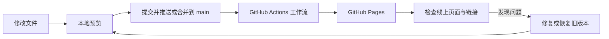

# Portfolio 最新维护说明（合并版）

> 适用仓库：[youth0505/Portfolio](https://github.com/youth0505/Portfolio)
>
> 编写日期：2026-11-18
>
> 依据版本：`c4ee9624b6297fd22565df8ffdee9db83075f085`
>
> 文档来源：整合旧版维护指引和维护说明中仍适用的原则，并以当前代码为准。
>
> 配套阅读：[Portfolio 文件结构与关系说明](Portfolio-文件结构与关系说明.md)
>
> 本文是针对现有代码的最新操作指南；代码块中的新增页面、颜色、数据均为示例，尚未写入网站。后续仓库结构变化时，需要相应更新本指南。

## 1. 日常维护先看这张表

| 你想做什么 | 首先打开 | 还要同步检查 |
|---|---|---|
| 改个人介绍、教育、技能、联系方式 | `index.html` | 手机上文字是否溢出 |
| 改已有经历 | `script.js` → `experiences` | HTML 中第一条经历的初始文案 |
| 增减经历节点 | `index.html` + `script.js` | `styles.css` 中固定四节点的布局与进度线 |
| 改主页/摄影页的颜色、字号、间距 | `styles.css` | 重复规则、手机端规则、另一页面是否被影响 |
| 改 F1 Dashboard 内容或样式 | [Dashboard 页面](https://github.com/youth0505/Dashboard/blob/main/f1-dashboard.html) | [Dashboard 仓库维护说明](https://github.com/youth0505/Dashboard/blob/main/MAINTENANCE.md)；Portfolio 只维护项目预览和唯一入口 |
| 换项目图片 | `assets/project/` + `index.html` | 缩略图 `src`、大图 `data-project-image` |
| 加减摄影照片 | `photography.js` → `photographs` | 图片文件、主色、排序、照片网格 |
| 替换简历 | 根目录 PDF | 主页两处链接、文档中的文件名 |
| 新增页面 | 新建 `.html` | 入口、返回链接、样式与脚本路径、标题与描述 |
| 删除页面 | 先清除所有入口，再删文件 | 共享资源是否仍被使用、旧链接如何处理 |
| 修改发布方式 | `.github/workflows/static.yml` | Pages 配置、分支、Actions 运行结果 |

**记住当前三个页面的区别：**

```text
index.html        → styles.css + script.js
photography.html  → styles.css + photography.js
Dashboard 仓库的 `f1-dashboard.html` → 独立页面，CSS 写在页面内部；当前没有 JavaScript
```

主页和摄影页共享外观，但脚本分别维护。F1 项目在 Portfolio 主页保留一份项目预览和一个进入链接；独立页面及其样式由 `youth0505/Dashboard` 仓库维护。

## 2. 每次更新的标准流程

1. **确认基线**：保留当前可工作的版本，查看是否已有其他未完成修改。
2. **确定范围**：本次改的是文字、样式、交互、页面还是发布配置。
3. **找到来源**：在项目中搜索现有文字、class、图片名或目标链接。
4. **完成修改**：同步改动相关引用，避免只更新一处。
5. **本地预览**：检查主页和受影响页面；共享 CSS 修改后，要同时检查摄影页。
6. **发布前检查**：检查链接、图片、手机布局和关键交互。
7. **提交并发布**：记录本次修改，推送或合并到 `main`；现有工作流会尝试自动部署。
8. **线上复核**：确认部署成功，再打开线上页面检查实际显示。

较大的外观或页面调整建议在独立分支完成，预览确认后再合并。不要把所有内容更新与视觉重做混在一次修改里，这样更容易定位问题和恢复。

### 本地预览方法

在实际的 `Portfolio` 仓库根目录启动静态预览服务。如果电脑有 Python 3，可以运行：

```sh
python3 -m http.server 8000 --bind 127.0.0.1
```

然后访问 `http://127.0.0.1:8000/`。结束时按 `Ctrl+C`。

这个命令只用于本地预览，不会部署网站。也可以使用编辑器的静态网站预览功能。若端口已被占用，可改用 `8001`。

## 3. 修改外观

### 3.1 修改整体配色

打开 `styles.css`，先找最前面的 `:root`：

```css
:root {
  --ink: #171817;
  --paper: #f5f4ef;
  --acid: #c9ebd5;
  --soft: #dce5de;
  --violet: #cfc4f4;
  --lavender: #d9cff5;
  --mint: #c9ebd5;
}
```

| 变量 | 大致控制什么 |
|---|---|
| `--ink` | 主要深色文字、线条、深色模块 |
| `--paper` | 米白背景、浅色卡片、深色区上的浅色文字 |
| `--acid` | 强调色、数字、部分背景与按钮 |
| `--violet` | 菜单与项目区等紫色区域 |
| `--lavender` | 摄影页首屏等浅紫区域 |
| `--mint` | 薄荷绿装饰与模块色 |
| `--soft` | 已定义，当前共享样式未引用 |

例如，把紫色调整得更淡，可以修改 `--violet` 的值。修改后要检查文字和背景是否仍容易辨认。

需要特别留意：

- 一些颜色直接写成十六进制色值，没有使用变量，需要按模块另改。
- `--acid` 与 `--mint` 当前颜色相同，但它们是两个独立变量。
- 主页与摄影页 `<head>` 中的 `theme-color` 要分别检查。
- Dashboard 独立页有自己的 `--v`、`--m` 等变量，不会继承 Portfolio 共享样式的修改。
- 摄影作品色带来自 `photographs` 数据；主页摄影入口色带则是 CSS 中的固定渐变。

### 3.2 修改字体

共享样式使用三个字体变量：

```css
--display: "Archivo Black", sans-serif;
--body: "Inter", sans-serif;
--mono: "DM Mono", monospace;
```

操作顺序：

1. 在需要更新的 HTML 的 Google Fonts 链接中加载目标字体及字重。
2. 修改共享 CSS 的字体变量。
3. 如果 Dashboard 独立页也需要保持一致，修改 `Dashboard/f1-dashboard.html` 中的字体链接与内部 CSS。
4. 检查大标题换行、按钮宽度、正文行高与手机显示。

仅修改字体变量但没有加载字体，浏览器可能会回退到系统字体。若新增中文正文，应另选适合中文的字体回退方案；现有字体配置主要服务英文展示。

### 3.3 修改字号、间距、模块高度

先从 HTML 找到元素的 `class`，再在 CSS 中搜索对应选择器。

| 目标 | 搜索位置 | 常改属性 |
|---|---|---|
| 首屏大标题 | `.hero h1` | `font-size` / `font`、`line-height`、`letter-spacing` |
| 首屏介绍文字 | `.hero-meta` | `width`、位置、正文大小 |
| 各区块上下留白 | `.section-pad` | `padding` |
| 各区块标题 | `.section-head h2` | 字号、行高、字距 |
| 教育卡片 | `.education-card` | `min-height`、`padding` |
| 经历详情框 | `.chain-stage` | 列宽、`gap`、`padding`、`min-height` |
| 项目画廊 | `.project-visual` | `min-height`、边界、溢出处理 |
| 摄影卡片 | `.exhibit` 及 `nth-child` | 网格跨度、图片比例、错落位置 |
| 联系区 | `.contact-inner` | `padding` 与内容间距 |

示例：只想让主页首屏标题稍小，可用主页专属范围：

```css
/* 桌面端示例；应整合进现有相关规则，避免长期重复追加。 */
@media (min-width: 821px) {
  .hero h1 {
    font-size: clamp(4.5rem, 12vw, 11rem);
  }
}
```

这里的 `clamp(最小值, 随屏幕变化的值, 最大值)` 让文字在范围内缩放。`gap` 是网格或弹性布局内部间距，`padding` 是元素内边距，`margin` 是元素外边距。

### 3.4 只改摄影页，不影响主页

摄影页的 `body` 已有 `.photo-archive-page`。修改时加上页面范围：

```css
.photo-archive-page .archive-hero {
  background: var(--paper);
}
```

新增页面也建议给 `body` 添加唯一 class，例如 `project-detail-page`，避免对 `h1`、`header`、`section` 等标签直接写过宽的全局规则。

### 3.5 手机端适配

- 共享样式主要在 `@media(max-width:820px)` 中调整。
- `Dashboard/f1-dashboard.html` 使用 `@media(max-width:760px)`。
- 桌面样式修改后，应检查是否存在单独的手机覆盖规则。
- 至少检查约 390px 的手机宽度、约 820px 的边界宽度和桌面宽度。
- 内容不能被固定高度截断，页面不应出现意外横向滚动。

例如，桌面三列、手机一列：

```css
.project-detail-page .detail-grid {
  display: grid;
  grid-template-columns: repeat(3, minmax(0, 1fr));
  gap: 1rem;
}

@media (max-width: 820px) {
  .project-detail-page .detail-grid {
    grid-template-columns: 1fr;
  }
}
```

### 3.6 调整动画

| 动画 | 外观部分 | 触发或计算部分 |
|---|---|---|
| 滚动显现 | `.reveal`、`.reveal.in-view` | 两个页面各自的 JS |
| 个人能力翻牌 | `.intro-card-inner` | CSS 悬停/焦点 + JS 点击状态 |
| 项目图片散射 | `.project-node` 与 CSS 变量 | `script.js` 的 `renderRadialGallery` |
| 顶部菜单展开 | `nav`、`nav.open` | `script.js` 的 `setMenu` |
| 圆环文字旋转 | `.orbit-copy`、`@keyframes spin` | JS 生成单字位置 |
| 图片大图开关 | 两套 lightbox 选择器 | 主页和摄影页各自的 JS |

保留现有 `prefers-reduced-motion` 支持。项目卡片的位置、缩放由 JS 持续写入变量，只改普通 `transform` 可能被已有规则覆盖。

**避免盲目追加样式：** 当前 `styles.css` 存在同名规则、旧规则和 `!important`。修改前搜索全部匹配项，优先修改实际生效的规则；调整后检查另一页面和手机端。

## 4. 修改页面内容

### 4.1 修改个人介绍、教育和技能

在 `index.html` 中通过现有可见文字搜索定位：

| 内容 | 搜索提示 |
|---|---|
| 首屏自我介绍 | `.hero-meta` 内的段落 |
| 个人定位大标题 | `.intro-copy` |
| Analyze / Visualize / Automate / Refine | `.intro-card` 正反面 |
| 成果数字 | `.stats` |
| 教育背景 | `.education-card` |
| 技能清单 | `.skill-list` |
| 联系方式 | `.contact-links` |

修改时尽量保留标签、class、`data-*` 和 `aria-*` 属性；这些可能被样式、脚本和辅助功能依赖。

更新个人定位时，建议始终围绕以下主线：数据分析与业务问题拆解、数据可视化与仪表盘设计、信息层级梳理与数据故事表达、AI 应用与流程数字化落地。主线应体现“分析能力 + 可视化表达 + 可落地的解决方案”，避免只罗列软件名称。

保持文字结构清晰：个人介绍说明“解决什么问题”，技能说明“用什么方法”，经历说明“做了什么、带来什么结果”。成果描述尽量采用“负责范围 + 方法或工具 + 可验证结果”的结构，并只公开脱敏后的信息。

HTML 中的 `&` 写成 `&amp;`，文字中需要显示 `<` 时写成 `&lt;`。长段落更新后，需要重新检查布局。

### 4.2 修改联系方式

- 邮箱：同时检查链接 `href="mailto:..."` 与可见文案。
- LinkedIn：主页首屏和联系区都有入口，需要一起更新。
- 简历：主页首屏和联系区各有一处链接。
- 地点、求职状态：顶栏、首屏、页脚可能分别存在相关文字。

不要只更新用户能看到的文字而遗漏实际链接地址。

### 4.3 修改已有经历

在 `script.js` 搜索 `const experiences`，找到对应对象：

```javascript
{
  number: '01',
  kicker: 'DATA → INSIGHT',
  company: '公司名称',
  role: '岗位 · 地点',
  summary: '这段经历的总结。',
  points: ['成果一。', '成果二。'],
  bridge: '能力衔接第一行<br/>第二行。'
}
```

- `number`：详情区编号。
- `kicker`：上方短标签。
- `company`、`role`、`summary`：公司、岗位与总结。
- `points`：成果列表。
- `bridge`：右侧能力衔接；现有代码允许这里使用 `<br/>` 换行。

第一条经历在 `index.html` 的 `.chain-stage` 中也写了一份初始内容，应同步更新。节点上的日期和短标题在 HTML 中，不在数组里。

这是 JavaScript 数据，字符串内有英文单引号时需要转义，或者选择合适的双引号包裹。不要直接粘贴带不配对引号的内容。`points` 和 `bridge` 会被写入 HTML，只填写自己维护的可信内容。

### 4.4 增加或删除经历

这项修改需要联动三处：

1. `index.html`：增加/删除 `.chain-node` 按钮，调整日期、序号和标签。
2. `script.js`：增加/删除对应 `experiences` 项，并保持**数组顺序与按钮顺序一致**。
3. `styles.css`：调整 `.chain-map` 列数、轨道起止位置和 `.chain-progress` 的宽度计算。

当前桌面布局写死四列，轨道两侧各留 `12.5%`，进度宽度采用 `75% / 3`。这些都对应四个等宽节点。

如果改成 `N` 个等宽节点，设计关系是：

- 首末节点中心离边缘：`50% / N`。
- 轨道总长度：`100% - 100% / N`。
- 每一步长度：轨道总长度除以 `N - 1`。

这些是计算依据，**不是可直接粘贴的 CSS**。手机端也有四列定义，需要同步调整。如果只保留一条经历，应取消多节点进度线逻辑，不能套用除以 `N - 1` 的公式。

完成后逐个点击节点，并测试左右方向键。当前事件处理主要根据按钮在列表中的位置确定数据；HTML 的 `data-chain-index` 也应保持连续，避免后续维护混乱。

### 4.5 修改 F1 项目预览与独立 Dashboard

- Portfolio 项目列表和预览只在 `index.html` 维护。保留现有 F1 项目卡片和唯一入口链接，不要再添加指向 Dashboard 的重复入口。
- 入口指向 `https://youth0505.github.io/Dashboard/f1-dashboard.html`。Dashboard 暂时不可用或页面路径更改时，先确认 Dashboard 仓库 Pages 部署和目标文件路径，再更新这个链接。
- 独立页面的内容和全部页面内 CSS 在 Dashboard 仓库的 [`f1-dashboard.html`](https://github.com/youth0505/Dashboard/blob/main/f1-dashboard.html)；具体维护方式见 [Dashboard 仓库的 `MAINTENANCE.md`](https://github.com/youth0505/Dashboard/blob/main/MAINTENANCE.md)。
- Portfolio 仓库不再保存 F1 独立页面副本。修改独立 Dashboard 时不要在 Portfolio 新建同名页面或重复复制样式。
- 独立页当前 KPI、图表、表格和下拉选项均为静态概念内容；下拉选项不驱动数据筛选。若实现真实仪表盘，需要在 Dashboard 仓库另行开发数据获取、筛选、计算、图表渲染和加载/错误状态。

## 5. 图片、照片与简历的维护

### 5.1 替换项目图片

**保持原文件名时：** 用新图片替换 `assets/project/` 中对应文件，再检查图片比例和内容。

**使用新文件名时：** 更新 `index.html` 中的两类路径：

```html
<button
  class="project-media"
  type="button"
  data-project-image="assets/project/new-project.webp"
  data-project-title="新的图片标题"
>
  
  <span>VIEW IMAGE ↗</span>
</button>
```

以上是示例，`new-project.webp` 需要自行准备。保留已有布局容器；添加到 `.project-media-strip` 后，还要检查其固定三列布局是否合适。

- `src`：页面缩略图。
- `data-project-image`：点击后加载的大图。
- `data-project-title`：大图标题。
- `alt`：图片内容描述。

材料接入公开页面前必须脱敏：删除客户、合作方、内部系统和未公开项目名称；隐藏账号、工号、设备编号、订单号、路径和内部链接；模糊姓名、邮箱、聊天记录和截图中的个人信息；替换真实业务数据，但保留数据结构、比例关系与方法逻辑；确认截图、报告、模型输出、代码片段均允许公开。无法公开的内容使用重绘图、模拟数据或概括性文字代替。

接入时应明确个人负责部分、希望保留的技术细节，以及明确不能公开的信息。先制作脱敏副本，再接入页面，不直接公开原始敏感材料。

当前项目大图脚本会收集主页所有 `[data-project-image]` 元素，无需手工修改图片总数。新增散射卡片则还需要设置散射参数和对应尺寸，不能只复制一张普通图片。

### 5.2 新增摄影作品

1. 将照片放入 `assets/Photo/`。
2. 打开 `photography.js`。
3. 在已有 `photographs` 数组中添加对象；不要再声明第二个同名数组。
4. 填写主色、色相、标题、地点/年份和描述。
5. 打开摄影页，核对排序、色带、数量与大图。

当前数组为空。接入仓库已有图片的示例：

```javascript
const photographs = [
  {
    title: '作品标题',
    caption: '地点 · 年份',
    image: 'assets/Photo/photo1.JPG',
    alt: '填写照片的实际内容描述',
    color: '#d5aa6d', // 示例主色，请按照片调整
    hue: 35           // 示例色相，请与主色对应
  }
];
```

每张新增作品使用相同字段，多个对象用逗号分隔。`hue` 为 0–360 的色相角度，脚本从小到大排序；`color` 为色带和卡片装饰使用的颜色。程序不会自动分析照片主色。

**只有一张照片时的现有边界问题：** 当前代码会拼出只有一个颜色项的 `linear-gradient`，浏览器可能不接受。需要把非空数组分支中的色带赋值改为支持单张作品的写法：

```javascript
spectrum.style.background = ordered.length === 1
  ? ordered[0].color
  : `linear-gradient(90deg,${ordered.map(item => item.color).join(',')})`;
```

这段应替换原来的非空分支赋值，保留空数组的占位渐变逻辑。

摄影网格对前八张有专门的 `nth-child` 排版。新增第九张及更多作品后，要检查后续卡片的网格跨度和比例，必要时增加通用规则；现有“可持续增加”数据结构并不保证任意数量的布局都已设计好。

### 5.3 删除或重新排序照片

- **删除展示：** 从 `photographs` 删除对象。
- **删除资源：** 全项目确认没有其他引用后，再删除对应图片文件。
- **改变顺序：** 修改 `hue` 会改变排序；仅调整数组中的前后位置，不会覆盖按色相排序逻辑。
- **全部移除：** 保留 `const photographs=[];`，摄影页会显示筹备状态。

如果以后改成在页面打开后动态增加照片，当前大图点击事件需要重新绑定或改成事件委托。现有流程是在首次生成照片后绑定事件。

### 5.4 替换教育校徽

修改 `assets/education/usc-seal.png` 或 `soochow-emblem.png`，若更名则同步改 `index.html` 的 `src`。

当前 `.edu-emblem` 使用灰度、变黑、低透明度和混合模式处理；上传彩色图片并不会直接变成彩色显示。若要显示原色，检查这些滤镜与透明度规则。

### 5.5 替换简历

实际文件名是：

```text
ZHU_LINGFEI_USC_Applied Data Science.pdf
```

现有链接写法是：

```html
href="ZHU_LINGFEI_USC_Applied%20Data%20Science.pdf"
```

建议保持文件名不变，替换 PDF 后测试首屏与联系区两处入口。若更名，更新两处链接和相关说明文档。

原 `README.md` 曾写 `ZHU_LINGFEI_Resume.pdf`，与实际文件名不一致；若更新简历说明，需使用实际文件名。公开 PDF 的内容和网页上的日期、教育、经历应保持一致。

## 6. 增加、删除或调整主页模块

### 6.1 增加普通内容模块

在 `index.html` 的 `<main>` 内选择插入位置。例如，在联系区前增加奖项模块：

```html
<section id="awards" class="awards section-pad" aria-labelledby="awards-title">
  <p class="section-label">/ AWARDS</p>
  <h2 id="awards-title">Awards</h2>
  <p>在这里填写奖项介绍。</p>
</section>
```

然后在 `styles.css` 增加限定范围的样式：

```css
.awards {
  background: var(--paper);
  color: var(--ink);
}

.awards h2 {
  font-family: var(--display);
}
```

若希望加入主页菜单，在现有导航中新增：

```html
<a href="#awards"><small>06</small>Awards</a>
```

按最终顺序调整菜单编号，并检查项目增多后菜单在较矮屏幕上是否能完整显示。`id` 必须唯一；链接 `#awards` 要与模块 `id="awards"` 一致。

主页已有滚动显现脚本，必要时可给元素加 `.reveal`。新页面如果没有对应脚本，不要使用这个类，否则元素可能始终透明。

### 6.2 删除模块

1. 搜索模块的 `id`、主要 class 与可见标题。
2. 删除对应完整 HTML 区块，避免误删相邻闭合标签。
3. 删除菜单、按钮和其他页面中指向该模块的锚点。
4. 检查 JS 是否直接依赖区块内元素。
5. 清理仅由该模块使用的样式和素材。
6. 测试剩余页面的交互。

**当前主页不能直接删除后就结束的元素：**

| 元素 | 原因 | 正确处理 |
|---|---|---|
| `.loader` / `[data-loader-count]` | 定时器直接操作元素，没有完整的存在性判断 | 同步移除或保护整段加载逻辑 |
| `[data-year]` | 脚本直接给查询结果赋值 | 删除元素时同步删除赋值，或增加存在性判断 |
| `.menu-toggle` / `#site-nav` | 脚本直接绑定菜单事件 | 同步移除或保护菜单逻辑 |
| `.orbit-copy` | 脚本直接读取文字并设置 HTML | 删除圆环时同步删除或保护文字生成逻辑 |

经历区、径向项目区和项目大图逻辑已有外层存在性判断，但删除其**内部一部分**时仍需检查。保留项目弹层却删除其中按钮，也可能导致报错。

先出现的 JavaScript 错误可能让后面的初始化停止，因此删除结构后需要检查菜单、翻牌和大图是否仍工作。

### 6.3 调整模块顺序

移动完整的 `<section>...</section>`，保留其唯一 ID、关联标题 ID、class 与数据属性。同步调整菜单顺序和编号。固定定位的弹层可继续保留在页面底部，不必随内容模块一起移动。

## 7. 新增独立页面

### 7.1 选择文件位置

对当前小型网站，优先把独立页面放在根目录，例如：

```text
project-detail.html
```

这样它与 `styles.css`、`index.html` 使用同级相对路径。若放在 `projects/detail.html`，返回主页和共享资源的路径就要改成 `../index.html`、`../styles.css` 等。

### 7.2 可复制的最小页面模板

新建根目录 `project-detail.html`：

```html
<!doctype html>
<html lang="zh-CN">
<head>
  <meta charset="UTF-8" />
  <meta name="viewport" content="width=device-width, initial-scale=1.0" />
  <meta name="description" content="在这里填写这个项目的页面简介。" />
  <title>项目详情 — Lingfei Zhu</title>
  <link rel="preconnect" href="https://fonts.googleapis.com" />
  <link rel="preconnect" href="https://fonts.gstatic.com" crossorigin />
  <link href="https://fonts.googleapis.com/css2?family=Archivo+Black&amp;family=DM+Mono:wght@300;400;500&amp;family=Inter:wght@400;500;600&amp;display=swap" rel="stylesheet" />
  <link rel="stylesheet" href="styles.css?v=detail-1" />
  <style>
    .project-detail-page .detail-header {
      padding: 1.5rem 4vw;
      border-bottom: 1px solid;
    }
    .project-detail-page h1 {
      font-size: clamp(2rem, 7vw, 5rem);
      line-height: 1.1;
    }
    .project-detail-page .detail-copy {
      max-width: 70ch;
      line-height: 1.7;
    }
  </style>
</head>
<body class="project-detail-page">
  <header class="detail-header">
    <a href="index.html#project">← 返回作品集</a>
  </header>
  <main class="section-pad">
    <h1>项目名称</h1>
    <p class="detail-copy">介绍项目背景、你的工作和最终成果。</p>
  </main>
</body>
</html>
```

这个模板不依赖主页脚本，文字可直接显示。英文页面可将 `lang` 改成 `en`。样式较多时，可把页面专用规则移到独立 CSS，并在共享样式之后加载。

**不要给新页面直接加载 `script.js`。** 它假定主页的菜单、加载器、圆环等存在。需要交互时，为新页面编写专用脚本，或者先将通用逻辑改成可安全复用的模块。

### 7.3 添加入口和返回路径

在主页合适位置添加：

```html
<a class="text-link" href="project-detail.html">
  VIEW PROJECT DETAILS <span>↗</span>
</a>
```

核对：

- 主页能打开新页面。
- 新页面能返回主页对应模块。
- 直接输入新页面地址也能正常打开。
- 页面标题、描述和语言正确。
- 新页面如需社交分享预览，补充自身的 `og:*` 等元信息。

### 7.4 新页面是否需要改部署配置

Portfolio 仓库的页面由 `.github/workflows/static.yml` 发布。F1 独立 Dashboard 位于单独的 `youth0505/Dashboard` 仓库，由该仓库自己的 Pages 部署工作流发布；Dashboard 页面内容不由 Portfolio 仓库部署。

新增普通 Portfolio 页面通常无需修改工作流；提交到发布分支的根目录内容会一起发布。若以后引入构建工具、生成目录或改变工作流上传路径，再调整相应仓库的部署配置。不要把本地草稿、素材备份或不准备公开的文件放进发布目录后提交。

## 8. 删除、隐藏和重命名页面

### 8.1 暂时隐藏页面入口

删除主页/菜单中的入口，但保留页面文件，适用于暂时不展示。此时知道地址的人仍可能访问页面；这只是隐藏入口。

### 8.2 完整删除页面

1. 在 Portfolio 和 Dashboard 仓库中搜索页面路径及指向它的链接。
2. 删除或替换 Portfolio 中指向该页面的入口。
3. 只有明确退役独立 Dashboard 时，才从 Dashboard 仓库删除页面文件。
4. 检查该页面的 CSS、JS、图片是否被其他页面共用。
5. 只清理确认不再使用的资源。
6. 更新 README、维护文档及必要的目录说明。
7. 发布后检查原入口已移除，其他页面没有失效链接。

**F1 独立页不在 Portfolio 仓库。** 若要从 Portfolio 隐藏 F1 项目，只移除或调整 `index.html` 中的项目预览及入口；只有在明确退役 Dashboard 时，才处理 `youth0505/Dashboard` 仓库中的页面和部署。不要因移除 Portfolio 入口而误删其他项目或共享样式。

### 8.3 重命名页面

假设将 Dashboard 仓库中的 `f1-dashboard.html` 改为 `race-explorer.html`：

- 重命名实际文件。
- 更新 Portfolio 项目预览中的唯一入口、Dashboard 页面的文档和分享地址。
- 检查页面内部返回链接与素材路径。
- 处理外部已分享的旧地址。

如果需要照顾旧链接，可以在旧文件名下保留一个跳转提示页：

```html
<!doctype html>
<html lang="zh-CN">
<head>
  <meta charset="UTF-8" />
  <meta name="viewport" content="width=device-width, initial-scale=1" />
  <meta http-equiv="refresh" content="0; url=race-explorer.html" />
  <title>页面已迁移</title>
</head>
<body>
  <p>页面已迁移至 <a href="race-explorer.html">Race Explorer</a>。</p>
</body>
</html>
```

这是浏览器页面跳转，不是服务器的 HTTP 301。保留此文件也意味着旧页面路径仍存在。

### 8.4 路径命名规则

- 新文件建议使用小写英文和短横线，例如 `project-detail.html`。
- 现有 `assets/Photo/` 和 `photo1.JPG` 的大小写必须原样匹配。
- 避免为新文件增加空格；已有简历空格需要正确编码。
- 当前是项目站点，优先使用 `assets/...`、`photography.html` 等相对路径。
- `/assets/...` 指向域名根目录，可能绕过 `/Portfolio/` 前缀而失效。
- HTML 中的相对路径基于页面位置；外部 CSS 的 `url(...)` 则基于 CSS 文件位置。

## 9. 发布、缓存与恢复

### 9.1 当前发布机制



Portfolio 工作流 `.github/workflows/static.yml` 与 Dashboard 工作流 `.github/workflows/deploy-pages.yml` 都支持 `main` 推送触发和手动触发。Dashboard 独立页发布地址为 `https://youth0505.github.io/Dashboard/f1-dashboard.html`。Dashboard 首次部署前，在该仓库的 **Settings → Pages → Build and deployment** 中将 Source 设为 **GitHub Actions**。不要把“提交成功”直接等同于“部署成功”；应检查对应仓库的工作流运行结果和页面实际内容。

### 9.2 修改后仍显示旧内容

按顺序排查：

1. 修改是否已经提交到 `main`。
2. 最新部署是否成功，是否仍在部署旧提交。
3. 当前地址是否正确，是否打开了旧页面。
4. 浏览器刷新或强制刷新后是否更新。
5. CSS/JS 文件请求是否来自新的资源 URL。

现有资源后有 `?v=profile-13`、`?v=photo-2` 等参数。需要时更新受影响页面的参数，例如：

```html
<link rel="stylesheet" href="styles.css?v=20261118-1" />
```

共享 CSS 被主页与摄影页分别引用，若要让两者主动请求新 URL，两处都要更新。参数没有自动版本管理功能；它只是 URL 的一部分。图片和 PDF 如果遇到同名缓存，也可更新引用参数，或更名并同步引用。社交平台的预览缓存需要在对应平台刷新，单纯刷新浏览器未必有效。

### 9.3 恢复旧版本

- 少量修改：恢复对应文件到上一个可用版本，再提交。
- 已发布的错误提交：优先使用撤销提交的方式恢复，并保留修改历史。
- 等待恢复版本完成部署，再检查页面。
- 不要用覆盖整个仓库的方式误删其他尚未发布的工作。

## 10. 常见问题排查

| 现象 | 优先检查 |
|---|---|
| F1 Dashboard 改 CSS 没变化 | 是否编辑了 Dashboard 仓库的 `f1-dashboard.html`；检查页面内 `<style>`、部署工作流和浏览器缓存 |
| 首页部分交互突然都不工作 | 浏览器控制台第一条错误；是否删除了脚本直接依赖的 DOM |
| 新页面文字看不见 | 是否使用 `.reveal` 却没有显现脚本；字体颜色与背景是否相同 |
| 图片本地可见、线上不可见 | 大小写、后缀、相对路径、是否提交了资源、是否误用 `/assets/` |
| 项目小图已更新，大图仍旧 | `src` 与 `data-project-image` 是否同时更新 |
| 摄影页仍显示筹备中 | `photographs` 是否仍为空；编辑的是否为 `photography.js` |
| 照片顺序与数组不同 | 程序按 `hue` 排序 |
| 单张照片没有对应主色色带 | 是否处理了单色渐变的边界情况，见 5.2 |
| 第九张以后的照片排版不理想 | 检查 `.exhibit:nth-child(...)` 与通用网格跨度 |
| 新增经历点错内容或进度线不对 | HTML 按钮顺序、JS 数组顺序、固定四节点的 CSS |
| F1 下拉选项不更新图表 | 当前 Dashboard 是静态概念内容，尚未实现数据筛选与联动 |
| 删除页面后还有 404 入口 | 全局搜索旧文件名和相关锚点 |
| 简历打不开 | 实际文件名、空格编码、两处链接、资源是否提交 |

## 11. 每次发布前的简明检查单

### 内容与资源

- [ ] 文案、日期、数字和链接准确。
- [ ] 图片、PDF 已提交，路径大小写完全匹配。
- [ ] 项目缩略图和大图都正确。
- [ ] 若更新经历，初始 HTML 和 JS 数据一致。
- [ ] 若增删页面，入口与返回链接已同步处理。

### 外观与交互

- [ ] 桌面和手机能阅读，内容不被截断，没有意外横向滚动。
- [ ] 共享样式更新后，主页和摄影页均检查过。
- [ ] 菜单、翻牌、经历节点、项目大图按预期工作。
- [ ] 摄影页的空状态或照片展示正常，大图能关闭。
- [ ] 键盘能到达主要链接与按钮，焦点可见。
- [ ] 浏览器没有阻断页面功能的脚本报错或资源加载失败。

### 发布与文档

- [ ] 本次修改有清楚的提交说明。
- [ ] GitHub Pages 工作流部署成功。
- [ ] 线上打开受影响页面，重新检查链接与资源。
- [ ] 涉及结构、路径或维护方法变化时，更新说明文档。

## 12. 可复用的更新记录模板

```markdown
### YYYY-MM-DD — 更新标题

- 更新目的：
- 修改文件：
- 内容变化：
- 外观变化：
- 页面/链接变化：
- 已检查的页面与设备宽度：
- 部署结果：
- 对应提交：
- 如需恢复，使用的旧版本：
```
